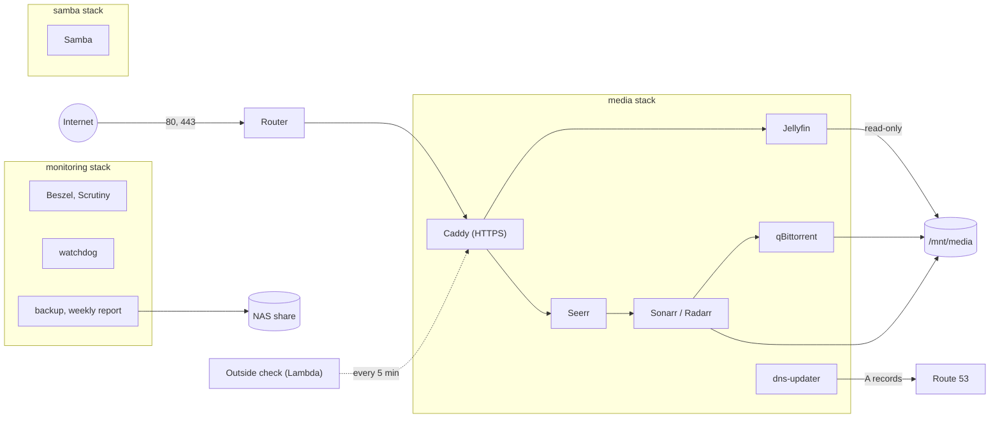

# home-media-server

A self-hosted media server for one Linux machine: Jellyfin behind HTTPS on your own domain, with
requests and automatic downloads, file shares, monitoring with email alerts, and nightly backups.
Everything runs in Docker Compose; the AWS side (DNS, email, an outside uptime check) is Terraform.

## Contents

- [What's in it](#whats-in-it)
- [Repository layout](#repository-layout)
- [Requirements](#requirements)
- [Getting started](#getting-started)
- [Configuration](#configuration)
- [Ports](#ports)
- [Updating](#updating)
- [Backups](#backups)
- [License](#license)

## What's in it

Three Compose stacks, each started on its own:

| Stack          | Services                                                                                                                     |
| -------------- | ---------------------------------------------------------------------------------------------------------------------------- |
| **media**      | [Jellyfin](https://jellyfin.org), [Caddy](https://caddyserver.com) (HTTPS), a dns-updater that keeps Route 53 on the home IP |
|                | `downloads` profile: [Seerr](https://github.com/seerr-team/seerr), Sonarr, Radarr, Prowlarr, FlareSolverr, qBittorrent, Bazarr, [Recyclarr](https://recyclarr.dev), [Cleanuparr](https://github.com/Cleanuparr/Cleanuparr) |
| **monitoring** | [Beszel](https://beszel.dev), [Scrutiny](https://github.com/AnalogJ/scrutiny), a watchdog that restarts unhealthy containers and emails; a weekly email report and a nightly [restic](https://restic.net) backup, run by timers |
| **samba**      | Samba file shares for Macs, Windows and phones                                                                               |

And in AWS, via Terraform: Route 53 records, IAM Roles Anywhere (the server gets AWS credentials
from a certificate, no access keys), SES for alert email, and a Lambda that checks the site from
outside every five minutes and puts up a maintenance page while the house is offline.



Every image is pinned to a version, and every service has a health check.

## Repository layout

```
.env.example                  every setting and secret, with placeholders
stacks/
  media/                      compose.yaml, Caddyfile, dns-updater/, recyclarr/
  monitoring/                 compose.yaml, watchdog/, weekly-report/, backup/, scrutiny/
  samba/                      compose.yaml, Dockerfile, smb.conf, avahi/
  */compose.override.example.yaml   this machine's hardware: GPU, drives, extra shares
systemd/                      home-media@.service (one per stack), backup and report timers
terraform/                    Route 53, Roles Anywhere, SES, the outside check
outside-check/                the outside check's Lambda and maintenance page
docs/router.md                port forwards and router settings
CLAUDE.md                     guidance for Claude Code; your own server's notes go in CLAUDE.local.md
```

## Requirements

- A Linux server (tested on Ubuntu 24.04) with Docker Engine and the Compose plugin
- Your media in one folder, or several drives pooled with [mergerfs](https://github.com/trapexit/mergerfs)
- A domain in Route 53 and an AWS account, for HTTPS on your own name, email alerts and the outside
  check (without them, run Jellyfin and the rest without the dns-updater and Terraform)
- A router that can forward ports 80 and 443
- Optional: Terraform 1.10+, an Intel iGPU for hardware transcoding, a NAS share for backups

## Getting started

1. **Clone** to `/opt/home-media-server` (or elsewhere, and change `WorkingDirectory` in the units).

   ```sh
   sudo git clone https://github.com/RaymanRJ/home-media-server.git /opt/home-media-server
   cd /opt/home-media-server
   ```

2. **Configure.** Fill in `.env`, and copy an override for any stack that needs this machine's
   hardware (the GPU for Jellyfin, drives for monitoring, extra Samba shares):

   ```sh
   cp .env.example .env
   cp stacks/media/compose.override.example.yaml stacks/media/compose.override.yaml   # and so on
   ```

   Create each app's data folder under `CONFIG_ROOT` before its first start (e.g.
   `mkdir -p ~/.jellyfin-config ~/.caddy`), so Docker doesn't create them owned by root.

3. **AWS** (optional). From `terraform/`, copy `backend.hcl.example` and
   `site.auto.tfvars.example`, then:

   ```sh
   terraform init -backend-config=backend.hcl
   terraform apply
   terraform output -raw server_env          # paste into .env
   terraform output -raw server_cert_pem     # save as ~/.dns-updater/cert.pem on the server
   terraform output -raw server_key_pem      # save as ~/.dns-updater/key.pem (chmod 600)
   ```

4. **Router.** Forward TCP 80 and 443 to the server (and 6881 for torrents); see
   [`docs/router.md`](docs/router.md).

5. **Start the stacks** at boot with systemd:

   ```sh
   sudo cp systemd/home-media@.service systemd/media-*.service systemd/media-*.timer /etc/systemd/system/
   sudo cp -r systemd/home-media@media.service.d /etc/systemd/system/
   sudo systemctl daemon-reload
   sudo systemctl enable --now home-media@media home-media@monitoring home-media@samba
   sudo systemctl enable --now media-backup.timer media-weekly-report.timer
   ```

   Or by hand: `cd stacks/media && sudo docker compose up -d`. Caddy gets the Let's Encrypt
   certificates on first start (`sudo docker logs -f caddy`).

6. **Set up the apps** in their web UIs (ports below), then check from a phone on mobile data.

## Configuration

- **`.env`** (repo root) holds everything that differs between machines: paths, user IDs, time
  zone, domains, API keys and passwords. Each stack reads it through its `.env` link.
- **`compose.override.yaml`** in a stack folder adds this machine's hardware; Compose merges it in
  on its own. See the `.example` next to each.
- **`COMPOSE_PROFILES=downloads`** in `.env` turns on the download apps; leave it empty for just
  Jellyfin and Caddy.
- **Docker from the snap:** use `snap.docker.dockerd.service` and `/snap/bin/docker-compose` in the
  units, and keep mounted paths under `/home` or `/mnt`.

## Ports

| Port         | Service                         | Reachable from              |
| ------------ | ------------------------------- | --------------------------- |
| 80, 443      | Caddy (Jellyfin, Seerr)         | The internet                |
| 6881         | qBittorrent's torrent port      | The internet                |
| 8096         | Jellyfin                        | Home                        |
| 5055         | Seerr                           | Home (and via Caddy)        |
| 8081, 9696, 8989, 7878, 6767, 11011 | qBittorrent, Prowlarr, Sonarr, Radarr, Bazarr, Cleanuparr | Home |
| 8090, 8080   | Beszel, Scrutiny                | Home                        |
| 445, 139     | Samba                           | Home                        |

Only what the router forwards is public. Scrutiny has no login, so keep it off Caddy.

## Updating

Images are pinned: change a tag in a stack's `compose.yaml`, then

```sh
cd stacks/<stack> && sudo docker compose pull && sudo docker compose up -d --build
```

Read the release notes first for Jellyfin and the download apps, which upgrade their databases.

## Backups

The monitoring stack's `backup` job runs nightly (`media-backup.timer`) and sends each app's data
folder, `.env` and anything added in its override to an encrypted restic repository on an SMB share
(`BACKUP_SHARE`). Keep `RESTIC_PASSWORD` in a password manager: without it the backup can't be
restored. To restore:

```sh
cd stacks/monitoring
sudo docker compose run --rm -v "$HOME/restore:/restore" --entrypoint restic backup snapshots
sudo docker compose run --rm -v "$HOME/restore:/restore" --entrypoint restic backup restore latest --target /restore
```

## License

[MIT](LICENSE)
